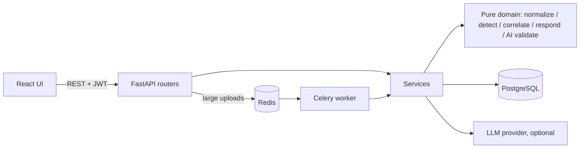

# Architecture

- `backend/app/domain`: framework-free logic, unit-tested. Routers stay thin; `services/` bridge DB and domain.
- Org isolation: every query filters by `ctx.org_id` taken from the verified token and re-checked against membership on each request; foreign IDs return 404.
- Severity score: base (info 10, low 30, medium 50, high 70, critical 90) + asset criticality bonus (0/3/7/10) + (confidence-0.5)*10, clamped 0-100; bands >=85 critical, >=65 high, >=40 medium, >=20 low.
- Detection evaluation is idempotent: same rule + same evidence set yields one alert.
- Extension points: add a `Rule` in `detection.py`; add an allowlisted action in `response.py`; add a provider branch in `ai/provider.py`.
